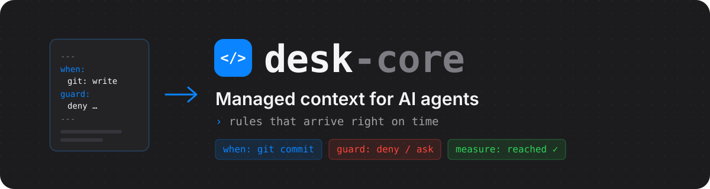

[Документация на русском](docs/index.md)



# desk-core

desk-core delivers your markdown rules to Claude Code **at the moment of the action
that needs them** — a `git commit`, a Bash command, a written path, a prompt, a skill,
an MCP tool — instead of loading everything at session start. **Guards** deny or ask
before a call runs, with the reason taken from the same rule file. Rules **switch by
repository**: a context (workplace) is chosen by the session's `git remote`. And
`desk measure` reads session transcripts to show whether a rule actually reached the
model when its trigger fired, and whether each guard held.

Claude Code already loads `.claude/rules/*.md` by file paths; `desk export
claude-rules` writes path-triggered rules in that format. desk-core adds the rest:
command, prompt, skill and tool triggers, guards, contexts and the measurement.

> desk-core is Claude Code hooks plus the `desk` CLI: Python 3.10+ stdlib, no model
> calls. It knows no tool, tracker or workplace — those live in your rules.
>
> **Status.** The author's own desk runs on the core, hooks wired in `settings.json`.
> Confirmed live: session start, delivery on prompts and calls, `deny` before a call.
> Also confirmed: install from GitHub — the CLI with `uv`, the hooks as a plugin through
> the marketplace. Not yet confirmed live: SessionEnd.
> Hook messages and CLI output are in Russian for now; localization is planned.

**Why.** One big `CLAUDE.md` loads into every session whole: the longer it grows,
the less attention each rule gets, and the commit rule drowns among the rules about
deploys and logs. desk-core keeps rules as separate files, delivers each when it is
needed, and stops what must not be missed before it runs.

## Concepts

| Term | What it is | Why |
| --- | --- | --- |
| rule | a markdown file: frontmatter says when to deliver it and what it forbids, the body is text for the model | a rule and its guard live in one file and do not drift apart |
| tier | the deadline by which a rule must be in context: `import` always (Claude Code itself reads it from `~/.claude/CLAUDE.md`, [how](#how-the-import-tier-reaches-the-model)), `session` from the start, `action` at its trigger (both delivered by the core's hooks), `link` by link only | every session carries only what is needed always; the rest waits for its moment |
| trigger (`when:`) | the event that brings an `action` rule: a command, a git subcommand, a written path, a prompt, a skill, an MCP tool | the commit rule arrives at `git commit`, not in every session |
| delivery, portion | a hook puts the rule's text into the model's context, in portions of up to 12 KB and 9k characters | Claude Code hides hook output longer than ~10k characters in a file the model does not see |
| slot | one of four SessionStart runs: slot 0 — header and lines, slots 1–3 — a portion of `session` files each | one hook output is not enough for a session start |
| guard | a check that denies a call or asks the human before it runs | an `action` rule arrives with the call's result and cannot change that call; a guard can |
| context, place | a folder `contexts/<name>/` with its own rules, chosen by `git remote` or path; a place is the context of a workplace | work rules stay apart from shared ones and leave with the job |
| portable layer | rules outside `contexts/`, with no names of a place | they can move to the next job or be published |
| reach | of the sessions where a rule's trigger fired, the share where its text was in context | a rule that does not arrive does not work |
| thread | what lasts longer than a session: an intention, an inquiry without a decision — a file in `threads/` plus a line in `now.md`; `now.md` is a `session` rule | what was said in one chat is known in the next |

## What's inside

**Core — rule delivery** (always on):

| Feature | What it does |
| --- | --- |
| Tiers and `when:` | a rule is in context always (`import`), from session start (`session`) or at the action (`action`): a Bash command, a git subcommand, a file path, a prompt, a skill, an MCP tool |
| Portions | Claude Code hides hook output longer than ~10k characters from the model, so a big rule is cut by sections into parts of up to 12 KB and 9k characters, the rest arrives with the next call; a rule is delivered once per session, and once more after compaction empties the context |
| `guard:` | `deny` or `ask` before a call: on the command, the commit message and subject, the written text, the paths, the tool input; the reason comes from the same rule file |
| Contexts (`contexts/`) | work and personal rules apart: a context is chosen by `git remote` or path; a workplace has its own triggers, repositories and branches, and its names do not leak into portable rules |
| Extensions (`ext/`) | Python checks where data is not enough, and your own lines on session events |

**Tools:** `desk lint` — rule structure; `desk why` — what fires on a call; `desk measure` —
whether rules reached the model and guards held, from session transcripts; `desk doctor` —
are the hooks wired; `desk init` — a desk from the template; `desk import` / `desk export` —
from `CLAUDE.md` and to `AGENTS.md` / `.claude/rules`.

**Extras** — habits around sessions and repositories. Off until a `desk.yml` key turns
them on (details [below](#extras-off-by-default)):

| Extra | Turn on | Why | What it does |
| --- | --- | --- | --- |
| Session header | `header: true` | you see which context a session started in and what it carries | a block at session start: place and repository, how many KB of rules were delivered and how many wait for a trigger, lines of the extras (checkout, sweep, meta); a widget in the desktop app |
| Session journal | `journal: journal` | a new session sees what the last ones did | on exit a line `date · repository · title` in `journal/YYYY-MM.md`; the last 10 lines at start |
| Meta signal | `meta_goal: 25` (with the journal) | tuning the rules must not eat the work | a header warning when sessions started inside `DESK_HOME` (work on the desk itself) exceed that share of the week |
| Threads | `threads: true` or `threads: {next: …, closed: …}` | what was said in one chat is known in the next — [below](#threads) | `desk lint` checks thread files and `now.md`: status, a next-step section when open, a closing line when closed, `now.md` size and freshness |
| Worktree and docker stack sweep | `sweep: true` | worktrees and stacks pile up and hold gigabytes; the sweep says what can go and what cannot | at start: the repository's git worktrees with a verdict — holds work (the only copy is here) / in work (its task is open) / fresh work (touched lately) / can go; what can go in every known checkout; docker compose — stacks up, stacks and volumes with no worktree; says so when docker does not answer. Removes nothing itself |
| Checkout to base | place `branches:`; `checkout: {auto: true}` | new work starts from a fresh integration branch, and an idle checkout does not pose as work | a line «on base / off base» with the command to fix it; with `auto` the hook moves a clean, pushed checkout to a fresh integration branch — not when another session works in it or the branch's task is in work |
| Session worktree | `desk init --hooks --worktree`; `worktree: {branch: …}` | parallel sessions do not get in each other's way in one folder | the `WorktreeCreate` hook: a tree in `<checkout>/.claude/worktrees/<slug>` from a fresh `origin/<integration>`, a branch by your pattern with no upstream, `.worktreeinclude` copied; on failure a plain `git worktree add` |
| `change_directory` hint | an extension with `@ext.checkouts` | a Claude desktop session works where its file panel looks | a command went to another known checkout of the same place — a one-time line «move there» (the desktop's `change_directory` tool) per repository |

## How it looks

A file `process/git.md` in your desk folder (`DESK_HOME`):

```markdown
---
tier: action
when:
  - git: write                  # deliver when the model runs a git command that changes something
guard:
  - deny-unless: '^(feat|fix|chore)\((no-ref|[A-Z]+-\d+)\): [a-z]'
    in: commit-subject          # check the commit subject
    why: subject — <type>(<TICKET>|no-ref): <description>
---
# Git
…rule text for the model…
```

The model calls `git commit -m "fixed bug"`. Before the call runs, the hook:

1. sees that `when: git: write` fired → puts the text of `git.md` into the model's context;
2. sees that the subject fails the `guard` → **denies the call** with the reason from `why`;
3. the model reads the reason and the rule, retries with `fix(no-ref): handle empty cart` — it passes.

A rule is delivered once per session. If the model already read the whole file, it is
not delivered again.

## Try it in 5 minutes

No install needed — a clone of this repository is enough:

```bash
git clone https://github.com/dqnison/desk-core ~/desk-core
alias desk=~/desk-core/bin/desk
desk init ~/desk-try                       # the default desk from desk/template/
export DESK_HOME=~/desk-try
desk why "git commit -m 'Fixed stuff.'"    # dry run: fires process/git.md, deny commit-format
claude --plugin-dir ~/desk-core            # a session with the hooks, this run only
```

The default desk: rules for git, tests, a task loop and threads, a safety pack, an
example workplace `contexts/example/` (Acme, `git.example.com`, repo `shop-api`) and a
`personal` context. `desk why` runs the hook code on one call — rules that fire, guard
decisions, what gets delivered — and executes nothing. Also: `--prompt 'make a commit'`,
`--tool Edit billing/pay.py --content 'x'`, `--cwd <dir>`, `--exit-code` (2 on deny, 1
on ask). In the `--plugin-dir` session ask for a commit "Fixed stuff." — it is denied.

## Install

**CLI** — any of:
```bash
uv tool install git+https://github.com/dqnison/desk-core       # or: pipx install git+https://…
uvx --from git+https://github.com/dqnison/desk-core desk init ~/desk   # run without installing
~/desk-core/bin/desk init ~/desk                                 # straight from a clone
```

**Hooks** — one of:
- As a Claude Code plugin — the repository is its own marketplace
  (`.claude-plugin/marketplace.json`):
  ```bash
  claude plugin marketplace add dqnison/desk-core
  claude plugin install desk@desk-core
  ```
  Or `claude --plugin-dir ~/desk-core` from a clone, for one session.
- Without the plugin: `desk init --hooks` prints a `hooks` block to paste into
  `~/.claude/settings.json`; `desk init --hooks --worktree` adds the `WorktreeCreate`
  hook (see Extras). Run it from a checkout or a persistent install (`uv tool` /
  `pipx`): under `uvx` the printed path points into uv's cache.

Then set **`DESK_HOME`** in `~/.claude/settings.json` under `env`
(`{"DESK_HOME": "/Users/<you>/desk"}`; the desktop app does not read your shell
profile; default `~/desk`), add the **`import` tier** as `@` lines to
`~/.claude/CLAUDE.md` ([how it reaches the model](#how-the-import-tier-reaches-the-model)),
and run **`desk doctor`**: Python, `DESK_HOME`, rule counts, the context of the current
folder, extensions, and whether the hooks are wired (plugin or `settings.json`). Hooks
wired twice deliver every rule twice.

**Coming from a CLAUDE.md.** `desk import CLAUDE.md` splits a file (CLAUDE.md,
AGENTS.md, `.cursorrules`) by `##` sections into `process/<slug>.md` rules of tier
`import`; nothing is overwritten. Point `@` lines at them and the model sees the same
as before. Then give sections a `when:` and tier `action`, so they arrive at the action
instead of sitting in every session.

## Tiers: when the model sees a rule

`tier` in the frontmatter is the deadline by which the rule must be in context.

| `tier` | the model sees it | delivered by |
| --- | --- | --- |
| `import` | always, in every session | an `@`-import in `~/.claude/CLAUDE.md` — the only guarantee |
| `session` | before the first action of a session | the SessionStart hook, as content |
| `action` | when its `when:` fires | the hook on a prompt or a tool call |
| `link` | only if the model opens it by a link | nothing: reference |

### How the `import` tier reaches the model

The core does not deliver `import` rules — Claude Code does. At the start of every
session it reads `~/.claude/CLAUDE.md` and replaces each `@<path>` line with that
file's text. So an `import` rule is part of the instructions the session starts
with, not a hook message: no trigger, portion or hook wiring can miss it. That is
the guarantee, and the price — it costs every session, so `desk lint` warns when an
`import` rule is over 8 KB (a cap on that cost, not a portion: no hook cuts it).

1. `desk init <DESK_HOME>` prints an `@` line for every `import` rule. On an existing
   desk it copies nothing and just prints the lines for the rules you have now.
2. Paste them into `~/.claude/CLAUDE.md`.
3. Set `entry: '~/.claude/CLAUDE.md'` in `desk.yml`: `desk lint` then checks both ways —
   every `import` rule has its line, and every line points at an `import` rule. A new
   `import` rule without its line is a lint error, not a rule the model silently
   never sees. Without `entry` nothing checks the lines.

Other assistants do not read `@` lines: `desk export agents-md` writes the `import`
tier into one `AGENTS.md`.

The limit of `action`: the rule arrives **with the result** of the call that fired it,
so it no longer affects that call. If a rule must work the first time, use a `guard`
(decided before the call), `gate: true` (below) or a `prompt:` trigger (the rule
arrives with the prompt, before any tool).

Claude Code hides hook output longer than ~10k characters in a file with a preview,
and the model does not see it. So a larger rule is cut by `##` sections into portions
of up to 12 KB and 9k characters ("part 1 of 3"); the rest comes with the next call. The core remembers
what it delivered in the session and does not deliver it twice; `clear` and `compact`
empty the context — rules arrive again.

`since: <date>` in the frontmatter — the day `desk measure` counts the rule's reach
from; set it when a rule is rewritten and older sessions no longer measure it.

`enabled: false` in the frontmatter switches a rule off without deleting it: it is not
delivered and its guards do not apply; `desk lint` still checks it.

## `when:` — when to deliver

A list of entries; the rule fires if any entry matches. Inside an entry all keys must match.

| key | fires on | example |
| --- | --- | --- |
| `tool` | tool name, glob | `tool: 'mcp__monitoring*'` |
| `command` | Bash command, case-sensitive regex | `command: '\bdocker compose\b'` |
| `input` | a tool input field, regex | `input: {path: '/logs'}` |
| `paths` | a file the call **writes** (Edit/Write, or Bash: `>`, `tee`, `sed -i`, `cp`, `mv`, `rm`, scripts) | `paths: ['billing/']` |
| `skill` | a skill call by name | `skill: [tracker]` |
| `git` | `write` — a git subcommand that changes something; or a list of subcommands | `git: [worktree]` |
| `desk` | `true` — a write into `DESK_HOME`, or a command run from inside it | `desk: true` |
| `prompt` | the user's prompt, case-insensitive regex; one per entry | `prompt: 'logs\|deploy'` |

`gate: true` in an entry: the first such call, while the rule is not in context yet, is
denied together with the rule text; the retry passes. For rules that must shape the
choice of action ("logs come from the log store, not the container").

Globs: `**` crosses folders, `*` does not, `billing/` means everything inside. A
relative glob is matched against the path from the file's git root (or from
`DESK_HOME`); a file outside both matches only absolute globs.

**Shared triggers.** A condition many rules need is defined once in `desk.yml` and used
by name — `when: [tests, mr]` (names and regular entries mix):

```yaml
triggers:
  mr:
    - command: 'mr-cli|merge_request'
    - skill: [merge-requests]
```

**`also:`** — a rule pulls others in when it fires: `also: [process/sensitive.md]` on a
repository's paid-code rule delivers the general paid-code rule, which has no `when:`.

## `guard:` — what to stop

```yaml
guard:
  - deny: 'Co-Authored-By|Generated with'   # a match is a violation
    in: commit-message
    id: commit-no-attribution
    why: no tool attribution in commits
  - ask: 'billing/'                          # for in: paths — a glob
    in: paths
  - deny: '"target_branch": "main"'
    in: input                                # tool input as JSON
    tool: 'mcp__*merge_request*'
    why: merge requests go to develop
```

| key | value |
| --- | --- |
| decision | `deny`, `ask` (ask the human), `deny-unless` / `ask-unless` (a violation when it does **not** match) |
| `in` | `command` (default), `commit-message`, `commit-subject`, `content` (what the call writes), `paths` (files it writes), `input` (tool input as JSON — for MCP tools) |
| `tool` | optional: only for these tools (globs) |
| `paths` | optional: only for calls writing such files |
| `why` | the reason, seen by both the model and the human |
| `id` | the guard's name in `desk measure`; without it `<file>#<n>`, which breaks when guards are reordered |
| `since` | the date `desk measure` counts compliance from; requires `id` |

A guard is active whenever its rule is in scope (general or of the current context) —
no `when:` needed. `deny` applies every time, `ask` once per session. The rule text
reaches the model with the decision. The hook never rewrites the command.

**Starter safety pack.** The default desk ships `process/safety.md` (tier `link`,
guards only): deny `rm -rf` on `/`, `~` or `*`; ask before writing `.env`, `.env.*`,
`*.pem`, `id_rsa*` inside a repository. The example extension `ext/no_force_push.py`
denies `git push --force` to `main`, `master` or `develop`. Switch either off with
`enabled: false` (the rule) or by deleting the file.

## Contexts: workplaces and repositories

Everything tied to a workplace (hosting, tracker, repositories) lives in
`contexts/<place>/`. The hub `contexts/<place>/context.md` says when the place is active:

```yaml
---
tier: session
match:
  remote: ['git.example.com']   # substring of `git remote -v` in the session folder
  path: ['~/work/*']            # or the session folder
  default: true                 # or "when nothing else matched"
---
```

- Rules in `contexts/<place>/` apply only while the place is active; a session inside
  `DESK_HOME/contexts/<place>/` is always that place.
- Rules in `contexts/<place>/projects/<repo>/` apply when a call touches that
  repository (named from its remote), in a session of any context.
- `skip_in: [desk, <place>]` on a `session` file: not delivered inside `DESK_HOME` or
  in the named place.
- `contexts/<place>/place-words.txt` — names of the place (company, hosts) that must
  not leak into portable files (`portable` in `desk.yml`; default: everything outside
  `contexts/`). An edit adding one is an `ask`; `desk lint` lists them.

## `desk.yml` — engine settings

An optional file at the root of `DESK_HOME`, kept apart from the rules: the `import`
tier loads into every session and must not carry engine data.

```yaml
portable: ['desk.md', 'process/**']   # the portable layer: no place names
entry: '~/.claude/CLAUDE.md'          # desk lint checks its @-imports against tier import
triggers: {…}                         # shared triggers, see when:
require_tier: ['process/*.md']        # desk lint: these files must have a tier
interfaces: {local: 'how to run', …}  # desk lint: allowed file names in projects/<repo>/
```

- **`portable`** — rules not tied to a workplace: they can move to the next job or be
  published, so the place's names (`place-words.txt`) are kept out of them.
- **`interfaces`** — one layout for every repository: `contexts/<place>/projects/<repo>/local.md`
  always means "how to run it locally", `tests.md` — "how to run the tests", and so on.
  A shared rule points at "the project's `local.md`" without knowing the repository;
  so only names from the dictionary are allowed there, and a file of one name arrives
  at one tier everywhere.

`contexts/<place>/desk.yml` defines triggers of the place under the same names: they
add to the root ones while the place is active. A portable rule says `when: [tracker]`;
the place says which CLI or API is its tracker. Where a place does not define the
trigger, the rule stays silent.

## Extras (off by default)

Not rule delivery but habits around sessions and repositories. By default the core does
none of this and never changes git state. Most are switched on by a key in the root
`desk.yml` (the session worktree also needs its hook, the `change_directory` hint — an
extension):

```yaml
header: true                      # session header as the first block (a widget in the desktop app)
journal: journal                  # session journal: a line on exit, the tail at start
meta_goal: 25                     # with journal: header signal when > 25 % of 7-day sessions ran in DESK_HOME
threads: true                     # threads: desk lint checks thread files and now.md
sweep: true                       # summary of worktrees and docker stacks at start
checkout: {auto: true}            # an idle checkout (clean, pushed) is brought to its base by the hook
worktree: {branch: 'wip/{name}'}  # branch of the session worktree; hook: desk init --hooks --worktree
```

The place's branches go to `contexts/<place>/desk.yml`, e.g. `branches: {integration:
develop, production: main, repos: {shop-api: {integration: dev}}}`. With them, session
start says whether the checkout is on its base and which command brings it there
(read-only unless `checkout: {auto: true}`; the branch is kept). The session worktree
is created from the integration branch.

### Threads

A thread is what lasts longer than one session: an intention ("let's get back to it
after the release"), an inquiry that ended without a decision, an agreement for
later. Without threads every session starts from zero.

- **What it looks like.** A file `threads/<slug>.md` (about the desk at the root, about
  a place under `contexts/<place>/threads/`) with `status: open` and a next-step
  section, and a line in the `now.md` next to it: a title, the state, a link.
- **How it reaches a session.** `now.md` is a `session` rule: every session starts with
  the list of open threads, so `now.md` stays under 4 KB.
- **Who keeps them.** The assistant, in the session where it came up, by the template's
  `process/threads.md`; a thread that ended in a decision gets a closing line.
- **What `threads: true` checks.** An open thread is listed in `now.md` and has a next
  step; a closed one has a date and an outcome; `now.md` is not too big and not
  forgotten. The words default to `## Next` and `**Closed <date>.**`; your own:
  `threads: {next: Дальше, closed: Закрыта}`.

Example: "let's get back to the cache after the release" comes up. The assistant opens
`threads/cache.md` with "Next: measure cache misses after the release" and a line in
`now.md`. A week later a new session starts with that line in context and brings it up
itself.

## Extensions: checks in code

What a regex cannot express is a Python file in `DESK_HOME/ext/`:

```python
from desk import ext

@ext.live("no-force-push", "no force push to a shared branch")
def no_force_push(call, session):          # before the call
    if "push --force" in call.command:
        return ("deny", "desk: push a fix on top instead")

@ext.compliance("no-force-push")
def cases(record, home): ...               # for desk measure: [(ok, what)]
```

- `@ext.lint(id)` — `fn(home) -> [(path, line, message)]` for `desk lint`.
- `@ext.on(event)` — text for the model on `SessionStart`, `UserPromptSubmit`,
  `PreToolUse`, `PostToolUse`; `SessionEnd` has no output. `ev` carries `session`,
  `call`, `data` (hook input), `state` (`state.notes` for "say it once"), `changed`
  (files a command changed) and at start `header` (`.row(...)`, `.signal(...)`).
- `@ext.in_work` — `fn(names, context) -> True | False | None`: is work on a branch
  alive (say, its tracker status); a busy checkout is not reset, a worktree not swept.
- `@ext.checkouts` — `fn(session) -> [path]`: the machine's checkouts for the sweep
  and the `change_directory` hint.

A crashing extension does not break the hook; the error arrives as a line. Shared code
goes into a package (`ext/mylib/`): only `ext/*.py` load as extensions, and `ext/` is on
`sys.path`, so `from mylib import x` works. A full example:
[desk/template/ext/no_force_push.py](desk/template/ext/no_force_push.py).

## Commands

| command | does |
| --- | --- |
| `desk why '<command>'` | dry run of the hooks on one call; `--exit-code`: 2 on deny, 1 on ask |
| `desk lint` | checks `DESK_HOME`: frontmatter, `when`/`guard`/`also`, `desk.yml`, size, links, contexts, place names; with `entry` — the `@`-imports |
| `desk measure [--days 28]` | from transcripts in `~/.claude/projects`: weight per tier, in how many sessions a fired rule reached the model, compliance of each guard. A rule counts from its start — its `since:` or the day its file was added to git; `measure: {since: 2026-11-13}` in `desk.yml` cuts off every earlier session (the day you moved to the core, say) |
| `desk init [dir]` | the default desk and the wiring steps; `--hooks` prints the `settings.json` block, `--worktree` adds `WorktreeCreate` |
| `desk doctor` | Python, `DESK_HOME`, rules (and which are `enabled: false`), context here, extensions, hooks wired |
| `desk import <file>` | CLAUDE.md / AGENTS.md split by `##` into `process/*.md`, tier `import` |
| `desk export agents-md --out <project>` | the `import` tier as one `AGENTS.md` (Codex, Cursor and others read it) |
| `desk export claude-rules --out <project>` | `action` rules triggered only by `paths:` as `.claude/rules/*.md` with a `paths:` field |

`--home <dir>` picks another `DESK_HOME`. Export takes portable rules only (outside
`contexts/`); guards and other triggers have no equivalent there and are skipped.

## Debugging

- `desk why` first: it shows the hook's decision exactly as the hook would make it.
- What the hook returned shows in the session transcript as `[desk] …` lines.
- `DESK_NO_DENY=1` — lifts every `deny` (and `gate`); `ask` stays.
- `DESK_HOOKS_OFF=1` — hooks stay silent (service sessions such as `claude -p`).
- Delivery state — `$TMPDIR/desk-core/<session>.json` (or `DESK_STATE_DIR`).

## Repository layout

```
.claude-plugin/        plugin.json and marketplace.json — install as a plugin
hooks/hooks.json       hooks: SessionStart (slot 0 + 3 file slots), UserPromptSubmit,
                       PreToolUse, PostToolUse, SessionEnd
bin/desk               CLI
bin/desk-hook          entry point of every hook
desk/                  delivery: frontmatter, home, when, deliver, guards, hook, messages
                       tools: cli, lint, measure, transcripts, port, ext, checks
                       extras: header, journal, threads, checkout, worktree, trees
desk/template/         the default desk for desk init
pyproject.toml         package desk-core: commands desk and desk-hook (uvx/pipx)
tests/                 python3 -m unittest; run by .githooks/pre-commit
docs/index.md          the guide in Russian, one file per topic
docs/decisions.md      what was checked and why it is built this way
```

## License

MIT — see [LICENSE](LICENSE).
