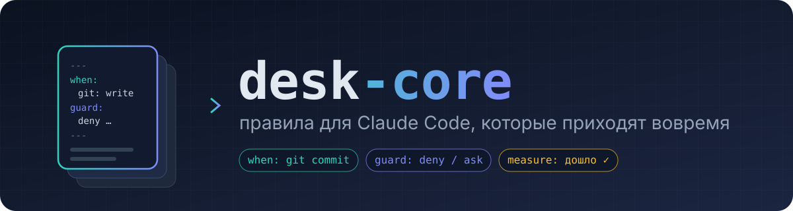

# Руководство desk-core

Подаёт ассистенту (Claude Code) **твои правила работы в нужный момент** и **останавливает
вызовы, которые правила запрещают**.

Правила — обычные markdown-файлы в одном каталоге (`DESK_HOME`). В шапке каждого файла
написано, когда его показывать модели и что он запрещает. Ядро — это хуки Claude Code
и CLI `desk`; само оно не знает ни одного инструмента, трекера или места работы — всё это
в правилах.

Сам Claude Code грузит `.claude/rules/*.md` по путям файлов — `desk export claude-rules`
пишет правила с `paths:` в этот формат. Остальное — триггеры на команду, реплику, скилл
и инструмент, запреты, контексты и замер `desk measure` — добавляет ядро.

## Разделы

- [Как это выглядит и попробовать за 5 минут](try.md)
- [Установка и подключение к Claude Code](install.md)
- [Правила: ярусы и `when:`](rules.md)
- [Запреты: `guard:`](guards.md)
- [Места работы и репозитории](contexts.md)
- [Настройки `desk.yml`](config.md)
- [Дополнения: деревья и стеки, чекаут, журнал, нити, шапка](extras.md)
- [Расширения на Python](extensions.md)
- [Команды `desk` и отладка](commands.md)

## Что в нём есть

**Ядро — доставка правил** (работает всегда):

| Возможность | Что делает |
| --- | --- |
| Ярусы и `when:` | правило в контексте всегда (`import`), с начала сессии (`session`) или в момент действия (`action`): команда Bash, git-подкоманда, путь файла, реплика, скилл, MCP-инструмент |
| Порции | крупное правило режется по разделам на части до 12 КБ, остаток приходит следующим вызовом; одно правило не приходит дважды за сессию, после сжатия контекста — снова |
| `guard:` | запрет (`deny`) или вопрос человеку (`ask`) до вызова: по команде, сообщению и заголовку коммита, записываемому тексту, путям, вводу инструмента; причина берётся из того же файла правила |
| Места (`contexts/`) | рабочие и личные правила отдельно: место выбирается по `git remote` или пути, у места свои триггеры, репозитории, ветки и слова, которых нет в общих правилах |
| Расширения (`ext/`) | проверки на Python, где данных мало, и свои строки на событиях сессии |

**Инструменты:** `desk lint` — структура правил; `desk why` — что сработает на вызов;
`desk measure` — дошли ли правила и держались ли запреты, по истории сессий; `desk doctor` —
подключены ли хуки; `desk init` — папка правил из шаблона; `desk import` / `desk export` —
перенос из `CLAUDE.md` и в `AGENTS.md` / `.claude/rules`.

**Дополнения** — привычки работы с репозиториями: свод git-деревьев и docker-стеков, чекаут к базе, дерево сессии, журнал, «мета», нити, шапка, подсказка `change_directory`. Выключены, пока не включишь ключом в `desk.yml` → [extras.md](extras.md).

## Раскладка репозитория

```
.claude-plugin/        plugin.json и marketplace.json — установка плагином
hooks/hooks.json       хуки: SessionStart (слот 0 + 3 слота файлов), UserPromptSubmit,
                       PreToolUse, PostToolUse, SessionEnd
bin/desk               CLI
bin/desk-hook          вход всех хуков
desk/                  пакет: доставка — frontmatter, home, when, deliver, guards, hook,
                       messages; инструменты — cli, lint, measure, transcripts, port, ext, checks;
                       дополнения (выключены по умолчанию) — header, journal, threads,
                       checkout, worktree, trees
desk/template/         скелет DESK_HOME для desk init
pyproject.toml         пакет desk-core: команды desk и desk-hook (uvx/pipx)
tests/                 python3 -m unittest; .githooks/pre-commit гоняет их перед коммитом
                       (git config core.hooksPath .githooks): код ядра работает живыми хуками
docs/decisions.md      что проверено и почему сделано так
```

English: [README.md](../README.md) · решения и проверки: [decisions.md](decisions.md)
